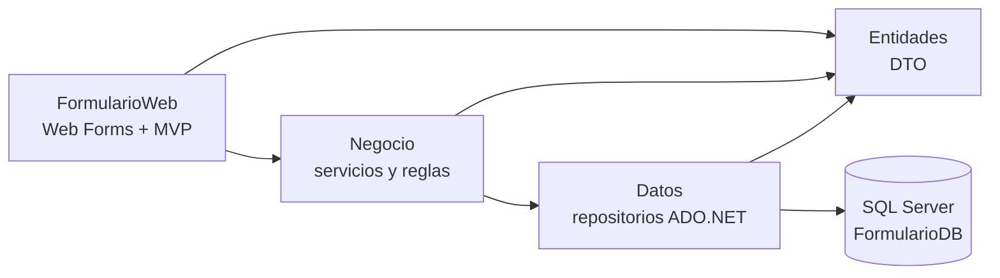

# Revisión frente a la guía del reto integrador

## Avances incorporados

- **Funcionalidad:** gestión CRUD de actividades y estudiantes, filtros, detalle, inscripciones con límite de cupo, retiro de inscripción, cuenta de estudiante, reseñas y exportación CSV legible en configuración regional colombiana.
- **Arquitectura:** proyectos separados `FormularioWeb`, `Negocio`, `Datos` y `Entidades`, todos en .NET Framework 4.7.2. El flujo de carga de actividades usa `IActividadesView` y `ActividadesPresenter`.
- **Validación y seguridad:** parámetros SQL, validaciones en negocio y servidor, hash PBKDF2 con sal, transacciones para cupos y eliminación de dependencias, codificación HTML en mensajes y reseñas.
- **Base de datos:** scripts idempotentes para el modelo inicial y extensiones. Inscripciones enlazan estudiantes y actividades por FK; una vista presenta nombres de lectura sin duplicarlos en la tabla relacional.
- **Documentación:** README con configuración, orden de scripts y ejecución.

## Diagrama de capas

## Pendientes antes de entregar

1. **Autorización administrativa:** el portal exige cuenta de estudiante, pero las páginas administrativas todavía no tienen inicio de sesión de administrador. No compartir la aplicación como si los roles ya estuvieran protegidos.
2. **MVP completo:** la carga del listado está delegada al Presenter; las acciones restantes de la página aún se coordinan en el code-behind y se deben migrar gradualmente.
3. **Reseñas:** el estudiante puede calificar desde sus inscripciones cuando la actividad ya terminó; confirmar con el grupo/docente si también se debe exigir una inscripción y si mostrar reseñas públicas.
4. **Pruebas y evidencias:** recorrer y capturar registro/inicio de sesión, CRUD, cupo agotado, duplicados, cancelación, retiro de inscripción, reporte y recuperación tras errores.
5. **Entrega reproducible:** probar los scripts en una base vacía de práctica, revisar el ERD, generar el informe y ZIP, y crear/verificar el repositorio GitHub accesible para la docente.

## Casos de aceptación sugeridos

| Área | Caso | Resultado esperado |
|---|---|---|
| Cuenta | Crear cuenta y volver a iniciar sesión | Contraseña no visible en BD; sesión identifica la cuenta |
| Actividades | Crear y editar con fechas correctas | Registro aparece actualizado |
| Validación | Fecha final anterior o cupo cero | Operación rechazada con mensaje claro |
| Cupos | Intentar inscribir cuando no hay cupos | No crea inscripción |
| Duplicados | Inscribir dos veces a la misma persona | Segunda solicitud rechazada |
| Retiro | Retirar inscripción desde el detalle | Inscripción desaparece y cupo queda disponible |
| Eliminación | Eliminar estudiante con dependencias | Confirmación informa cantidad; al aceptar elimina dependencias en transacción |
| Reporte | Abrir CSV en Excel/WPS con configuración regional española | Columnas separadas y acentos legibles |

## Evaluación orientativa

La guía asigna mayor peso a funcionalidad (25%) y arquitectura (25%). El proyecto cubre una parte amplia del flujo funcional y ya tiene proyectos separados, pero debe completar el Presenter, centralizar reseñas, cerrar autorización de administrador y reunir evidencias antes de considerarlo listo para sustentación.
